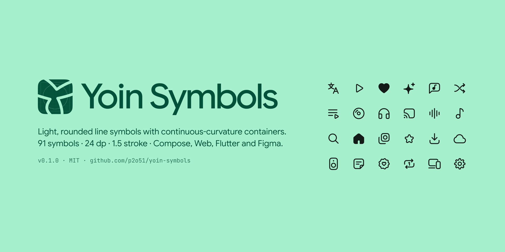

# Yoin Symbols



一套轻、圆、容器带连续曲率的线条图标。96 个符号最初是为音乐播放器 Yoin 画的，现在从同一份源码生成 Jetpack Compose、Web、Flutter 和 Figma 四个版本。

[图库](https://p2o51.github.io/yoin-symbols/) · [Figma](https://www.figma.com/design/g0H4CfkagF8p1N4vuPYxQA) · [npm](https://www.npmjs.com/package/yoin-symbols) · [pub.dev](https://pub.dev/packages/yoin_symbols) · [Maven Central](https://central.sonatype.com/artifact/io.github.p2o51/yoin-symbols) · [English](README.md)

| 平台 | 包名 | 安装 |
| --- | --- | --- |
| Jetpack Compose、Android View | `io.github.p2o51:yoin-symbols` | `implementation("io.github.p2o51:yoin-symbols:0.1.0")` |
| Web、React | `yoin-symbols` | `npm i yoin-symbols` |
| Flutter | `yoin_symbols` | `flutter pub add yoin_symbols` |
| Figma | Yoin Symbols 组件库 | 复制文件，或启用已发布的团队库 |
| 其他 | [`svg/`](svg) | 直接拷文件 |

- 24 × 24 网格，1.5 描边，圆端点、圆转角
- 连续曲率容器（圆角平滑 60 %）
- 线条交叉处真的断开，不靠遮罩
- 10 个符号有实心版，外沿和线框版完全重合
- 7 个符号在 Compose 里带动效，用 Material 3 Expressive 的 spring

## Jetpack Compose

```kotlin
dependencies {
    implementation("io.github.p2o51:yoin-symbols:0.1.0")
}
```

```kotlin
import com.gpo.yoin.symbols.YoinSymbols

Icon(YoinSymbols.Translate, contentDescription = "翻译")
Icon(YoinSymbols.HomeFilled, contentDescription = null, tint = MaterialTheme.colorScheme.primary)
```

每个符号是一个 `ImageVector`，第一次用到时才构建。`YoinSymbolCatalog.all` 把名字映射到生成符号的函数，适合做图标选择器。非 Compose 场景用同名的 VectorDrawable：`com.gpo.yoin.symbols.R.drawable.ic_yoin_translate`。

### 动效符号

返回 `Painter`，放进任何 `Icon` 都会跟随它的颜色。

| 函数 | 动作 |
| --- | --- |
| `rememberTranslateSymbolPainter(translating)` | 等待时 文 和 A 沿同一圆周交换位置，结束时总是回到 文A |
| `rememberPlayPauseSymbolPainter(playing)` | 三角切成两半，各自变成一根暂停条 |
| `rememberFavoriteSymbolPainter(favorite)` | 心跳一下，实心从中心长出 |
| `rememberExpandSymbolPainter(expanded)` | 箭头先压平再翻折，像合页 |
| `rememberEqualizerSymbolPainter(playing)` | 柱子追随随机高度，停止时以低刚度 spring 缩成圆点 |
| `rememberSparkleSymbolPainter(generating, filled)` | 大星每次转 90° 后停一下，小星错拍闪烁 |
| `rememberPlayModeSymbolPainter(mode)` | 一个播放模式按钮：随机 × 列表 / 单曲循环，共四种。环被剪开，下半股像翻牌一样翻成交叉的一股；单曲循环时「1」弹出，随机 + 单曲循环时「1」缩小滑进交叉左边的空隙 |

```kotlin
Icon(
    painter = rememberTranslateSymbolPainter(translating = uiState.isTranslating),
    contentDescription = if (uiState.isTranslating) "正在翻译" else "翻译",
)
```

循环动画总会走完当前这一拍再停，不会停在半路。系统把动画时长缩放设为 0 时，符号保持静止。想跟随自己的“减弱动效”设置：

```kotlin
CompositionLocalProvider(LocalSymbolMotion provides SymbolMotion.Reduced) {
    // 循环变成透明度呼吸，变形不再过冲
}
```

播放模式按钮用 `SymbolPlayMode.next()` 得到点一下之后的模式：列表循环 → 随机 → 随机 + 单曲循环 → 单曲循环，每次只变一样。`shuffle` 和 `repeatOne` 对应 Media3 的 `shuffleModeEnabled` 和 `REPEAT_MODE_ONE`（否则是 `REPEAT_MODE_ALL`）：

```kotlin
var mode by rememberSaveable { mutableStateOf(SymbolPlayMode.RepeatAll) }
IconButton(onClick = { mode = mode.next() }) {
    Icon(rememberPlayModeSymbolPainter(mode), contentDescription = "播放模式")
}
```

`SymbolMotion` 里是全部 spring 参数，有自己动效体系的 App 可以传入自己的值：`SymbolMotion.Default.copy(spatial = mySpring)`。

## Web

```js
import { Translate, toSvg } from 'yoin-symbols'           // SVG 字符串，可 tree-shake
el.innerHTML = toSvg('translate', { size: 20, title: '翻译' })

import { Translate } from 'yoin-symbols/react'           // React 组件
<Translate size={20} strokeWidth={1.25} />

import 'yoin-symbols/font/yoin-symbols.css'               // 图标字体
<i class="ys ys-translate"></i>
```

还有 SVG sprite（`yoin-symbols/sprite.svg`，id 是 snake_case 名）和包含名字、分组、码位的 `meta.json`。详见 [web/README.md](web/README.md)。

## Flutter

```dart
import 'package:yoin_symbols/yoin_symbols.dart';

Icon(YoinSymbols.translate)
```

以图标字体发布，大小和颜色跟随 `Icon` / `IconTheme`，release 构建只保留用到的字形。详见 [flutter/README.md](flutter/README.md)。

## Figma

[Figma 文件](https://www.figma.com/design/g0H4CfkagF8p1N4vuPYxQA)里每个符号都是组件，描边是真实的 1.5，颜色绑定 `icon/default` 变量（浅色 / 深色两个模式）。有实心版的合成一个组件，属性 `Style = Outline / Filled`。可以直接复制，也可以发布成团队库。Foundations 页写着网格和规则。

## 命名

每个符号只有一个 snake_case 名字，各平台按自己的习惯转换：

| 规范名 | Compose | Android 资源 | JavaScript、React | Flutter | CSS |
| --- | --- | --- | --- | --- | --- |
| `home_filled` | `YoinSymbols.HomeFilled` | `ic_yoin_home_filled` | `HomeFilled` | `YoinSymbols.homeFilled` | `.ys-home-filled` |

字体码位从 U+E000 开始，只增不改：一个符号的码位永远不变。`web/dist/meta.json` 记录了每个符号替代的 Material 图标，从 Material 迁移时可以对照。

## 在本地直接用

还没发布到 Maven Central，或者正在改图标时，可以让 App 直接引用本地仓库。

**Android，任何 AGP 版本。** 发布到本机 Maven 仓库：

```sh
cd android && ./gradlew :yoin-symbols:publishToMavenLocal
```

```kotlin
// App 的 settings.gradle.kts
dependencyResolutionManagement {
    repositories {
        mavenLocal { content { includeGroup("io.github.p2o51") } }
        google()
        mavenCentral()
    }
}
```

**Android，改完即生效。** 用复合构建把依赖替换成源码。App 和本项目的 Android Gradle Plugin 版本一致时最稳（这里是 9.1）：

```kotlin
// App 的 settings.gradle.kts
val yoinSymbols = file("../yoin-symbols/android")
if (yoinSymbols.exists()) includeBuild(yoinSymbols)
```

**Web。** `npm i ../yoin-symbols/web`

**Flutter。**

```yaml
dependencies:
  yoin_symbols:
    path: ../yoin-symbols/flutter
```

## 仓库结构

```
generator/          唯一的源：每个符号一个 Python 函数，加上各平台的生成器
  icons/            几何工具和符号本身（icons_nav.py、icons_music.py……）
  build.py          重新生成下面所有内容
svg/                规范 SVG
android/            Compose 库：生成的 ImageVector 与 drawable，手写的动效
web/                npm 包
flutter/            pub 包和示例图库
docs/               图库网站（GitHub Pages）、设计与动效说明
```

```sh
pip install -r generator/requirements.txt
python3 generator/build.py
```

生成物也提交进仓库，CI 会检查它们和源码是否一致。新增符号见 [CONTRIBUTING.md](CONTRIBUTING.md)，发布流程见 [RELEASING.md](RELEASING.md)。

设计说明：[docs/zh-CN/DESIGN.md](docs/zh-CN/DESIGN.md) · [docs/zh-CN/MOTION.md](docs/zh-CN/MOTION.md)

## 许可

MIT。所有符号都是原创绘制；设计语言参考了 Google 的 Luminous 符号，但没有复用任何轮廓。
